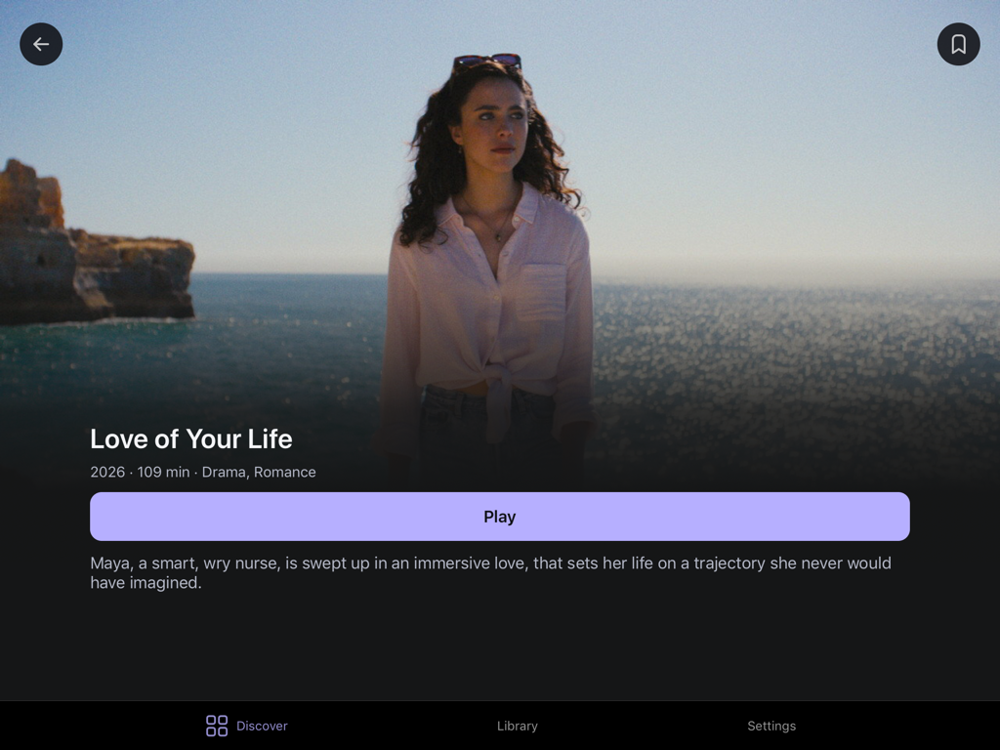

<p align="center">
  
</p>

<h1 align="center">StremIOS</h1>

<p align="center">An independent, native Stremio-compatible client for older iPads.</p>
<p align="center">Cinematic browsing. Familiar controls. No browser engine.</p>

<p align="center">
  <a href="#features">Features</a> ·
  <a href="#set-up">Set up</a> ·
  <a href="#build-from-source">Build from source</a> ·
  <a href="#compatibility">Compatibility</a>
</p>

<p align="center">
  
</p>

<details>
<summary>Made for portrait, too</summary>

<p align="center">
  
</p>

</details>

<p align="center"><sub>Captured on an iPad mini 2. Illustrative title artwork belongs to its respective owners.</sub></p>

## Features

- **Browse beautifully.** Discover movies and series through a compact catalog picker, with search and filters supplied by your installed add-ons. Cinematic title pages bring together seasons, episodes, IMDb ratings and optional logos, with a stable fallback when artwork fails.
- **Pick up where you left off.** Continue watching, Saved and History stay on your device. Resume looks for the previously selected source without storing an expiring playback URL.
- **One player interface.** Native HLS playback and VideoLAN for supported MP4/MKV sources share the same controls: audio, captions, seeking, picture size and pinch to zoom.
- **Make it yours.** Accent colours, caption appearance and timing, language preferences and bounded artwork storage. No analytics or background video downloads.
- **Bring your add-ons.** Add compatible manifest URLs in Settings. Sources resolve only after an explicit Play or Resume; browsing never starts a media download.

## Set up

After installing your build, open **Settings → Add-ons**:

- **Configured add-on link:** paste your provider's configured `https://` or `stremio://` manifest link. StremIOS checks the manifest before saving it; add-ons that require configuration guide you back to their provider.
- **Connect TorBox:** validate an API key directly with TorBox, then choose whether to share it with **Torrentio**, a separate service. Nothing is sent to Torrentio until you confirm that connection.

In **Discover**, use the compact Movies/Series buttons, catalog selector and Filters. Catalogs are grouped by add-on; tap outside a catalog or filter sheet to close it without applying changes. Filters come from that catalog's manifest—Hindi appears when the provider offers a language list containing it. Search appears only where supported; Clear resets the selected filters. Compatible catalogs, metadata, sources and subtitles are supported, not every Stremio add-on feature. Connections and viewing history stay local; there is no Stremio account sync.

## Build from source

**This initial public release is source-only.** There is no ready-to-install IPA or bundled VideoLAN framework in this repository. Public binary distribution is held until the corresponding-source package is complete.

Requires macOS, **full Xcode with iOS platform support**, Python 3.9+ and Git. Command Line Tools alone are insufficient. Complete Xcode's first-launch setup before building.

```sh
git clone https://github.com/siiddhantt/stremios.git
cd stremios

# Select your installed Xcode for this shell, if needed.
export DEVELOPER_DIR=/Applications/Xcode.app/Contents/Developer

# Fetch and verify the pinned playback dependency and source archives.
python3 Vendor/MobileVLCKit/fetch-vlckit.py --sources

# Build an arm64 iPad app without downloading a simulator.
MS_LAUNCH_MODE=static-ipad12 ./scripts/build.sh
```

The IPA is written to `build/StremIOS-iOS12.ipa`; downloaded dependencies stay in `.cache/vlckit/`. The build explicitly targets iOS 12.0. The static launch option supports all four iPad orientations but opts out of Split View and Slide Over. Omit `MS_LAUNCH_MODE` for the default storyboard launch path.

The current script **ad-hoc signs** the app and framework. The tested installation uses AppSync on a jailbroken iPad. A stock-device installation would need valid Apple signing and provisioning for both; that route is not automated or validated here. StremIOS itself requests no root, JIT or debugger entitlements. Upgrades retain the original bundle identifier and storage keys to preserve existing libraries and add-on connections.

<details>
<summary>Checks and custom build locations</summary>

```sh
python3 tests/validate_project.py
python3 tests/test_launch_assets.py

# Optional: fail if the iPhoneOS SDK is unavailable.
python3 tests/validate_project.py --require-sdk

# Optional: use another dependency cache and output directory.
python3 Vendor/MobileVLCKit/fetch-vlckit.py --cache /absolute/cache --sources
MS_VLCKIT_FRAMEWORK=/absolute/cache/arm64/MobileVLCKit.framework \
  MS_LAUNCH_MODE=static-ipad12 ./scripts/build.sh /absolute/build-output
```

These are host checks, not device-playback tests. `--fixtures-only` validates the offline protocol fixtures; `--app /path/to/StremIOS.app` also inspects a built app without installing it.

</details>

## Compatibility

StremIOS targets **arm64 iPads on iOS 12 or later**; the tested device is an iPad mini 2 running iOS 12.5.8. It is an iPad app, not an iPhone build. Start with 720p or 1080p H.264 on this hardware. HEVC, AV1, 4K/HDR and demanding codecs are outside the intended path; provider delivery can still fail for otherwise supported files.

External SRT/WebVTT captions support appearance and timing controls. Embedded captions depend on the playback engine: native HLS uses iOS styling; supported VLC text captions can be styled, while bitmap and ASS subtitles have limitations. Adaptive-quality preferences do not transcode fixed files.

There is no torrent engine, transcoder, DRM bypass or Stremio account sync. Add-ons provide their own content; StremIOS includes no films or streaming subscription. This is an independent project, unaffiliated with Stremio. Report reproducible problems through [Issues](https://github.com/siiddhantt/stremios/issues), including the iPad model, iOS version and media format—never private source URLs or credentials.

## Privacy and license

History and preferences are local. Configured add-on URLs may contain credentials; they use a private, backup-excluded file with iOS Complete Data Protection. Keep them out of commits, screenshots and issue reports. This protection does not isolate data from privileged jailbreak software.

App code is [MIT licensed](LICENSE), © Siddhant Rai. Third-party code and illustrative artwork retain their own licenses. StremIOS dynamically links **MobileVLCKit 3.7.4**; the fetcher's `--sources` option includes verified VLCKit/VLC source archives and patches, but not every contrib dependency archive. It is not a complete offline corresponding-source package or a byte-identical rebuild claim. See the [dependency recipe](Vendor/MobileVLCKit/BUILDING.txt) and [third-party notices](Resources/ThirdPartyNotices.txt) before redistributing binaries.
