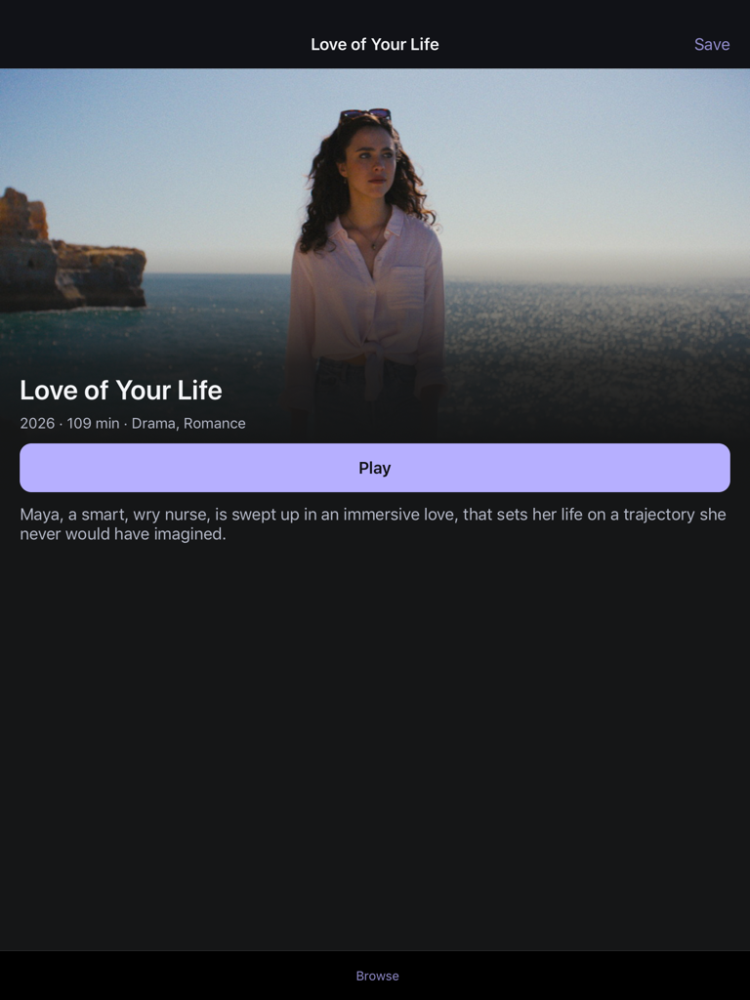

<p align="center">
  
</p>

<h1 align="center">StremIOS</h1>

<p align="center"><strong>Native streaming. A new life for older iPads.</strong></p>
<p align="center">An independent Stremio-compatible client with cinematic browsing and familiar playback controls.</p>

<p align="center">
  <a href="https://github.com/siiddhantt/stremios/releases/tag/v0.8.3-beta.1">Download beta</a> ·
  <a href="#features">Features</a> ·
  <a href="#get-started">Get started</a> ·
  <a href="#build">Build</a> ·
  <a href="https://github.com/siiddhantt/stremios/issues">Feedback</a>
</p>

<p align="center">
  
</p>

<p align="center"><sub>Captured on an iPad mini 2 running iOS 12.5.8.</sub></p>

<details>
<summary>See the portrait layout</summary>

<p align="center">
  
</p>

</details>

## Features

| Feature | Included |
| :--- | :--- |
| **Discover** | Artwork, title logos, IMDb ratings, seasons and episodes. Search and filter catalogs from your add-ons. |
| **Watch** | VideoLAN and native HLS playback, audio tracks, subtitles, tap-to-seek and pinch-to-zoom controls. |
| **Continue** | Save titles and resume your previous source. Library and viewing history stay on your device. |
| **Personalise** | Accent colours, subtitle styling, language preferences and a clearable artwork cache. |

No browser engine, analytics or background video downloads.

## Get started

**[Download the free beta](https://github.com/siiddhantt/stremios/releases/tag/v0.8.3-beta.1)** — IPA, Debian package, source archives and checksums.

- **New install on a rootful iOS 12 jailbreak:** [add the Sileo repository](https://siiddhantt.github.io/stremios/), then install StremIOS.
- **Already using the IPA:** update with the release IPA through Filza and AppSync; keep your existing app installed. The Sileo package deliberately refuses an automatic switch from an IPA.

The jailbreak must be active. Stock-device signing and rootless packages are not validated for this release.

Once installed:

1. Open **Settings → Add-ons & connections** and paste a configured `https://` or `stremio://` manifest link.
2. For TorBox, use **Connect TorBox**. Sharing your key with Torrentio, a separate provider, requires confirmation.
3. Choose a catalog in **Discover**, open a title and select a source.

Catalogs, filters and content come from your providers. Compatible metadata, source and subtitle add-ons are supported; Stremio account sync is not included. StremIOS supplies no films or subscriptions.

## Compatibility

| Device & media | Support |
| :--- | :--- |
| **Target** | arm64 iPads, iOS 12 and later. No iPhone build. |
| **Tested** | iPad mini 2 · iOS 12.5.8 · AppSync installation. Other devices and stock-device signing remain unverified. |
| **Recommended on mini 2** | 720p or 1080p H.264. HEVC, AV1 and 4K/HDR are outside the intended playback path. |

<details>
<summary>Playback and subtitle limits</summary>

- No torrent engine, transcoder or DRM bypass. A resolution preference cannot convert an incompatible file; provider links can expire or fail.
- External SRT/WebVTT captions support font, weight, colour, shadow, vertical offset and timing.
- Plain-text VideoLAN captions support live font, size, colour and weight changes. Reopen playback for shadow, background or position changes.
- Native HLS, styled ASS and bitmap subtitles may retain their own appearance. Embedded captions can crop when zoomed.

</details>

## Build

Requires macOS, **full Xcode with iOS platform support**, Python 3.9+ and Git. Complete Xcode's first-launch setup; Command Line Tools alone are insufficient.

```sh
git clone https://github.com/siiddhantt/stremios.git
cd stremios
export DEVELOPER_DIR=/Applications/Xcode.app/Contents/Developer
python3 Vendor/MobileVLCKit/fetch-vlckit.py --sources
MS_LAUNCH_MODE=static-ipad12 ./scripts/build.sh
```

Output: `build/StremIOS-iOS12.ipa`. Dependencies: `.cache/vlckit/`.

The script **ad-hoc signs** the app for jailbroken devices. Stock iPads need valid Apple signing and provisioning, which this script does not provide. The app requests no root, JIT or debugger entitlements.

<details>
<summary>Build options and checks</summary>

The static launch option supports all four orientations, but disables Split View and Slide Over. Omit `MS_LAUNCH_MODE` for the default storyboard launch path.

```sh
python3 tests/validate_project.py --require-sdk
python3 tests/test_launch_assets.py
```

These are host checks, not device playback tests. Pass `--fixtures-only` to validate offline protocol fixtures, or `--app /path/to/StremIOS.app` to inspect a build.

For custom locations:

```sh
python3 Vendor/MobileVLCKit/fetch-vlckit.py --cache /absolute/cache --sources
MS_VLCKIT_FRAMEWORK=/absolute/cache/arm64/MobileVLCKit.framework \
  MS_LAUNCH_MODE=static-ipad12 ./scripts/build.sh /absolute/build-output
```

Generate a rootful Debian package and static Sileo repository:

```sh
python3 scripts/package-deb.py --ipa build/StremIOS-iOS12.ipa \
  --output build/sileo-repo --base-url https://example.com/repo/ \
  --version '0.8.3~beta1' --extra-notices Resources/ThirdPartyNotices.txt \
  --source-instructions Vendor/MobileVLCKit/SOURCE-AND-RELINKING.txt
```

Use a new output directory and your final HTTPS address. This creates files locally; it does not install or publish them. Run `python3 packaging/test_package.py` to check the packaging logic.

</details>

## Privacy & license

History and preferences stay local. Configured add-on links may contain credentials; they are stored with iOS Complete Data Protection and excluded from backups. Privileged jailbreak software can still access app data. When [reporting a bug](https://github.com/siiddhantt/stremios/issues), include your device, iOS version and media format—never keys or private stream URLs.

App code: **[MIT](LICENSE)**, © Siddhant Rai. MobileVLCKit 3.7.4 and other dependencies retain their own licenses. Releases include dependency sources and notices; see the [dependency recipe](Vendor/MobileVLCKit/BUILDING.txt) for rebuilding and replacing the playback library, and [third-party notices](Resources/ThirdPartyNotices.txt) for attribution.

<p align="center"><sub>Independent project, unaffiliated with Stremio. Title artwork belongs to its respective owners.</sub></p>
